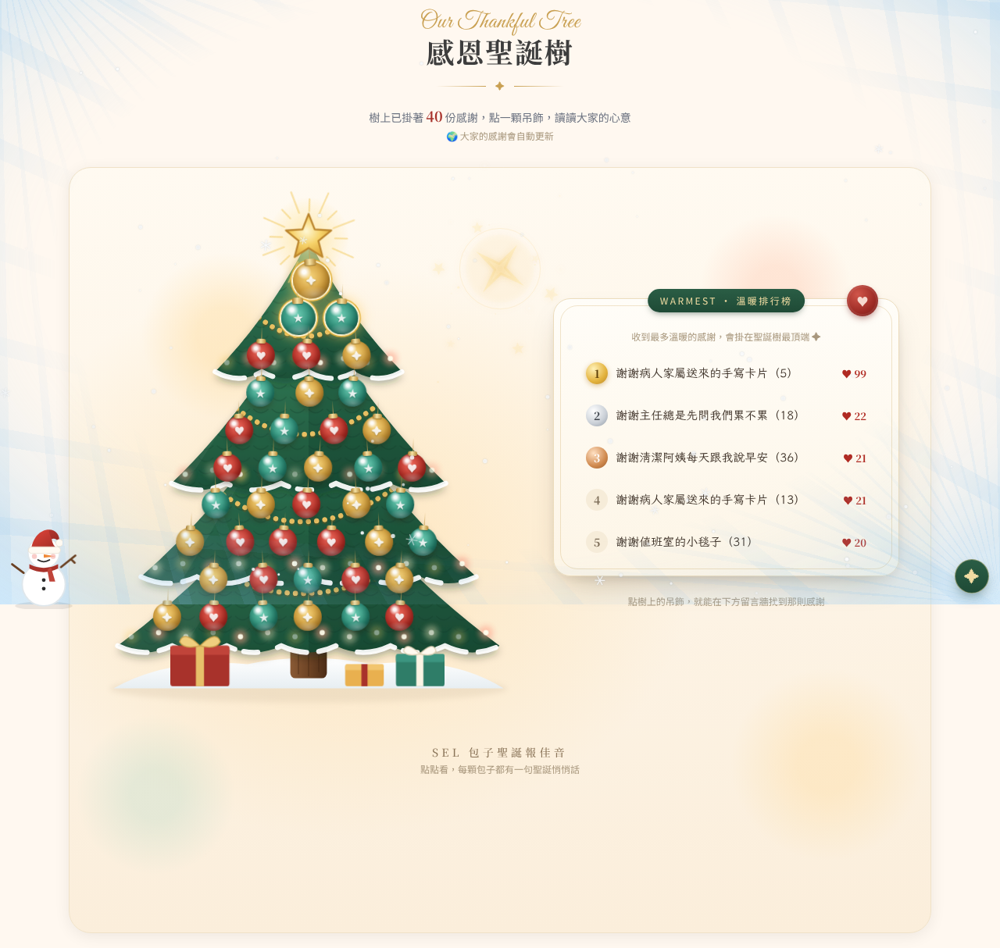

# 奇美醫院 SEL 學習小棧｜12月聖誕感恩活動

在 SEL 學習小棧首頁加入「這一年，謝謝你」聖誕感恩活動：
同仁寫下一年來最想感謝的**人、事、物**，掛上感恩聖誕樹；大家可以互送「溫暖 +1」，溫暖越多的感謝掛得越高。



## 檔案說明

這個儲存庫是 **SEL 學習小棧的完整網站**（原網站所有頁面與圖片 ＋ 新的聖誕感恩活動），整個資料夾就能直接運作。

| 檔案 | 用途 |
|---|---|
| `index-static.html` | 首頁（**已加入聖誕感恩活動**，上線時只需更新這個檔案） |
| `index.html` | 自動轉到 `index-static.html`（讓網站根網址也能打開首頁） |
| `abilities.html`、`selfcheck.html`、`scenario.html`、`learning-support.html`、`message-wall.html`、`game-heart.html`、`game-communication.html`、`quiz.html` | 原網站其他頁面（從正式網站複製，未修改；`game-heart.html` 的「首頁」連結已由不存在的 `index.html` 改為 `index-static.html`） |
| `public/` | 網站圖片（Logo、包子、插圖等） |
| `assets/quiz-data.js` | 測驗題庫 |
| `google-apps-script/Code.gs` | 聖誕感恩留言的後端程式（貼到 Google 試算表的 Apps Script） |
| `google-apps-script/設定教學.md` | Google 試算表開通的詳細步驟與日常管理 |
| `docs/screenshots/` | 畫面截圖 |

> 瀏覽人次計數器只在醫院正式網站上運作，在其他地方打開時不會顯示，屬正常現象。

## 功能

- **活動橫幅與跑馬燈**：Merry Christmas 金色標題、極光、燈串、飄雪；首頁中段有聖誕跑馬燈與五顆 SEL 包子
- **寫感謝**：選人／事／物、起頭句提示、可匿名、可選擇是否分享給大家
- **感恩聖誕樹**：每份感謝是一顆吊飾，**溫暖越多掛越高**，前三名有金色光環；名次改變時吊飾會滑到新位置
- **溫暖排行榜**：前 5 名，點一下跳到該則留言
- **感謝留言牆**：一次看到所有留言，可依「最多溫暖／最新」排序、篩選人事物，每則都能按「溫暖 +1」（文字上點兩下也可以）
- **互動特效**：全頁飄雪、魔法棒游標與金色星光、雪人寶寶、包子報佳音、送出後的慶祝卡；右下角 ✦ 可一鍵關閉
- **安全**：只能刪除自己的留言、溫暖一次只能 +1、管理者可在試算表隱藏不當留言、防公式注入與洗版

---

## 上線步驟（照順序做）

### 步驟 1：開通「大家看得到彼此留言」（約 10 分鐘）

> 沒做這步，網頁也能用，但留言只會存在每個人自己的瀏覽器，牆上會顯示 3 則範例。

1. 用 Google 帳號打開 <https://sheets.new>，建立試算表，命名例如「SEL 聖誕感恩留言」。
2. 點上方 **擴充功能 → Apps Script**，把編輯器內容全部刪掉，貼上 [`google-apps-script/Code.gs`](google-apps-script/Code.gs) 的全部內容，按 💾 儲存。
3. 右上角 **部署 → 新增部署作業** → 齒輪 ⚙️ 選 **網頁應用程式**：
   - 執行身分：**我**
   - 誰可以存取：**所有人**
4. 按 **部署** → **授權存取**（出現「Google 尚未驗證這個應用程式」→ 點「進階」→「前往（不安全）」→ 允許，這是自己的程式，屬正常提示）。
5. 複製出現的 **網頁應用程式網址**（結尾是 `/exec`）。

> 若用醫院的 Google Workspace 帳號找不到「所有人」選項，請改用其他帳號或洽資訊室。

### 步驟 2：把網址貼進網頁

打開 `index-static.html`，搜尋：

```js
var API_URL = '';
```

改成（貼上步驟 1 的網址）：

```js
var API_URL = 'https://script.google.com/macros/s/xxxxxxxx/exec';
```

存檔。開通後範例留言會自動消失。

### 步驟 3：（選用）放上聖誕包子插圖

把圖片放進網站的 `public/` 資料夾，檔名如下即會自動顯示；沒放就自動隱藏，不會破圖：

| 檔名 | 顯示位置 |
|---|---|
| `public/xmas-buns-sweater.jpg` | 活動橫幅標題下方的主視覺 |
| `public/xmas-buns-snow.jpg` | 送出感謝後的慶祝卡 |

### 步驟 4：上傳網站

正式網站上**只需要更新 `index-static.html`**（其他頁面與圖片原本就在網站上）。把它上傳，**取代**原本的
`https://www.chimei.org.tw/main/cmh_department/59400/SEL/index-static.html`
（要和 `public/` 資料夾在同一層）。上傳前建議先備份原檔。

### 步驟 5：上線後檢查

- [ ] 首頁能正常打開，跑馬燈上五顆包子的位置正確（若歪掉，調整 `.xt-bun` 的 `--x` 值）
- [ ] 用自己的電腦寫一則感謝、**勾選分享**、送出 → 試算表「感恩留言」分頁出現一列
- [ ] 請另一位同仁用他的電腦打開 → 看得到你的留言，按「溫暖 +1」→ 試算表 H 欄「溫暖數」變成 1
- [ ] 手機打開檢查一次
- [ ] 右下角 ✦ 可以關閉特效

---

## 日常管理

| 想做的事 | 怎麼做 |
|---|---|
| 隱藏不當留言 | 試算表「感恩留言」分頁取消勾選該列 **顯示**，1 分鐘內從大家的樹上消失 |
| 永久刪除 | 直接刪除該列 |
| 先審核再公開 | Apps Script 把 `NEED_APPROVAL = false` 改成 `true`，再「管理部署作業 → 編輯 → 新版本 → 部署」 |
| 看溫暖數 | 試算表 H 欄「溫暖數」 |
| 活動結束備份 | 試算表 **檔案 → 下載 → Excel / CSV** |

修改 `Code.gs` 後一定要用「管理部署作業 → 新版本」重新部署，網址不變、網頁不用改。

## 注意事項

- 本儲存庫若為公開，貼進 `index-static.html` 的試算表網址也會公開；網址只能新增／讀取已公開的留言，無法刪改別人的留言或讀到隱藏留言。
- 字型從 Google Fonts 載入；若醫院網路擋 Google Fonts，會改用一般字型顯示，版面不受影響。
- 包子圖片沿用網站原本的 `public/sel-mascots-cutout.png` 裁切顯示。
